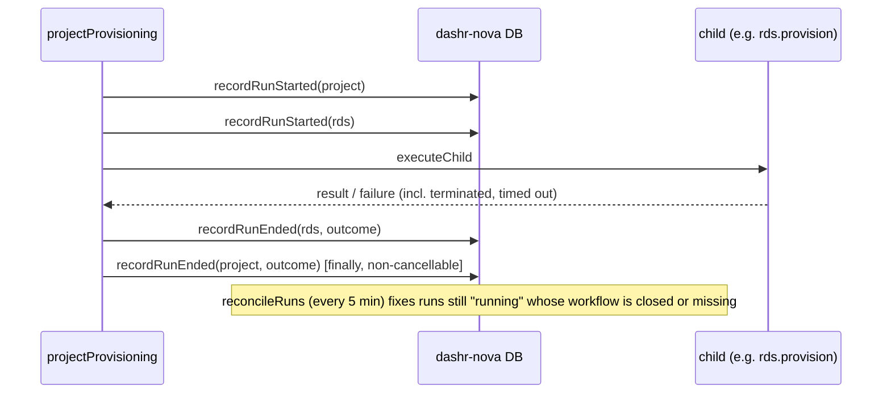

# Design: 0001 Workflow run tracking

## Approach
The orchestrator records runs; nothing else does. Recording is built into the
two places every run passes through, so no step can skip it:

- `child()` in `src/orchestrator/workflows/project-provisioning.ts`: record start (activity),
  `executeChild`, record end. The parent always learns a child's outcome,
  including termination and timeout (`ChildWorkflowFailure` with a
  `TerminatedFailure` / `TimeoutFailure` cause), so children never need the
  reconciler.
- The project workflow itself: record start first; record end in a `finally`
  run inside `CancellationScope.nonCancellable`, so cancellation is recorded
  too.

Only the project workflow's own termination, run timeout or loss escapes
both. A scheduled workflow, `reconcileRuns`, closes those gaps from Temporal's
record.



## Constitution check
| Principle | How |
|---|---|
| III Domain layer | Page reads history through a domain function (`getProjectRuns`) with the same read check as `getProject` |
| VI Long work is a workflow | The reconciler is a Temporal Schedule, not a cron in the web app |
| VIII Orchestrator writes state | Only orchestrator activities write `workflow_runs`; provisioners unchanged |
| IX Idempotent | Start is an upsert on workflow ID; end only updates `running` rows; the reconciler only writes closed or missing runs |
| X Additive contracts | New table only |

## Data
```sql
create table workflow_runs (
  workflow_id   text primary key,
  project_id    uuid not null references projects (id) on delete cascade,
  step          text not null,          -- project | entitlements | rds | …
  workflow_type text not null,          -- projectProvisioning | rds.provision | …
  status        text not null default 'running'
                check (status in ('running','completed','failed','cancelled','terminated','timed_out','lost')),
  error         text,
  started_at    timestamptz not null default now(),
  ended_at      timestamptz,
  ended_by      text check (ended_by in ('workflow','reconciler'))
);
create index workflow_runs_open on workflow_runs (started_at) where status = 'running';
create index workflow_runs_project on workflow_runs (project_id, started_at desc);
```

## Flows
- Activities: `recordRunStarted`, `recordRunEnded` (in `src/orchestrator/activities/`).
- `statusOf(err)`: `CancelledFailure` → cancelled, `TerminatedFailure` → terminated, `TimeoutFailure` → timed_out, else failed.
- `reconcileRuns` workflow on `dashr-nova-orchestration`, registered by the worker, scheduled at worker start via `client.schedule.create` (idempotent ID `reconcile-runs`, every 5 minutes, overlap policy SKIP). Activities: `listStaleRuns(olderThan)`, `describeWorkflow(id)` (Temporal client), `closeRun(id, outcome, endedAt, 'reconciler')`.

## Failure modes
- Recording activity fails: retried like other DB activities; the workflow does not proceed until recorded.
- Reconciler and workflow race to close a run: both write only where `status = 'running'`; first wins.
- Temporal unreachable: the reconciler's activities retry; nothing is marked lost unless Temporal answers "not found".

## Alternatives considered
- Read run status from Temporal on each page view: lost after retention, couples pages to Temporal availability.
- Provisioners record their own runs: breaks constitution VIII.

## Test plan
- REQ-PROV-011/012: end-to-end run with one failing stub service; assert rows and outcomes.
- REQ-PROV-012 (terminated child) and REQ-PROV-013: terminate a child and the parent with the Temporal CLI; assert statuses and `ended_by`.
- REQ-PROV-014: insert a `running` row with an unknown workflow ID; run the reconciler.
- REQ-PROV-015: render the project page; assert history rows.
